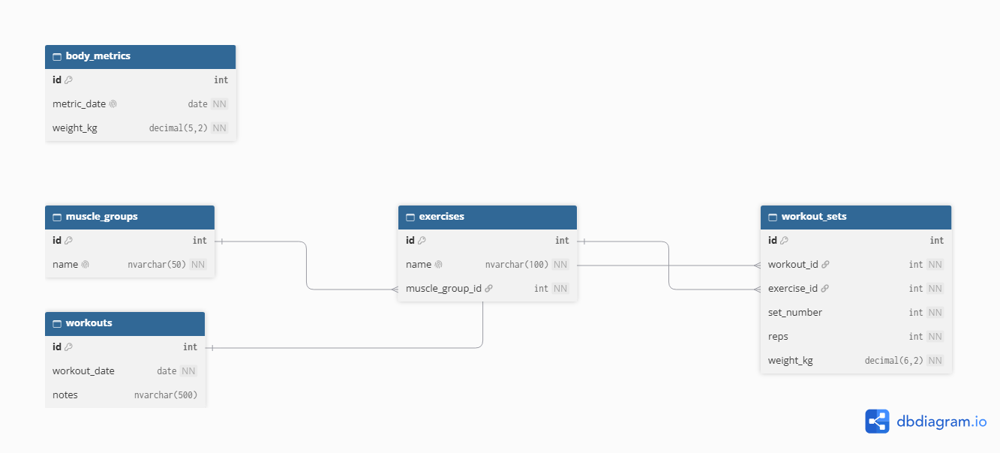

# Training Log

A training log for recording gym workouts, built as a SQL Server database with an ASP.NET Core API on top. I'm building it for my own training, and as a way to practise database design, layered architecture and testing.

**Status:** in progress (started October 2026).

## Plan

- [ ] SQL Server database: schema, sample data, a transaction, views, reports and indexes
- [ ] ASP.NET Core Web API with controllers, services and repositories, plus unit tests
- [ ] Front-end, login, deployment and an AI feature (later)

## Planned tech

SQL Server (T-SQL), C#, ASP.NET Core, Entity Framework Core, xUnit.

## Database design

Five tables:

| Table | Purpose |
|---|---|
| `muscle_groups` | Chest, back, legs and so on |
| `exercises` | Each exercise, linked to a muscle group |
| `workouts` | One row per training session |
| `workout_sets` | The sets in a workout: exercise, weight, and reps, a duration or a distance |
| `body_metrics` | Body weight over time, one entry per day |



## Transaction: all or nothing

A workout and its sets must be saved together. Without a transaction, a failure halfway through would leave a workout with only some of its sets. `database/03_log_workout_transaction.sql` inserts a workout and three sets inside `BEGIN TRY` / `BEGIN TRANSACTION`, with `SET XACT_ABORT ON` and a `ROLLBACK` in the `CATCH` block.

The script is committed in its failing form on purpose: the third set has `-5` reps, which the `ck_sets_reps` CHECK constraint rejects. To reproduce the proof:

1. **Run the script as it is.** It fails with a CHECK constraint error on `ck_sets_reps`.
2. **Check nothing was saved:** `SELECT * FROM dbo.workouts WHERE notes = 'Transaction test';` returns no rows. The workout was inserted before the failure, but the rollback undid it along with the first two sets.
3. **Change `-5` to `5` and run it again.** This time the workout and all three sets are saved.
4. **Clean up:** `DELETE FROM dbo.workouts WHERE notes = 'Transaction test';` removes the test workout, and `ON DELETE CASCADE` removes its sets.

This proves the database never keeps a partial workout. The Week 2 API relies on the same idea, because Entity Framework's `SaveChanges` wraps the workout and its sets in one transaction.

## Views

`database/04_views.sql` creates two views for reports I run often:

| View | One row per | Shows |
|---|---|---|
| `vw_workout_history` | workout | date, notes, total sets, exercises done, total volume (kg), total duration (s), total distance (m) |
| `vw_weekly_volume` | ISO week and muscle group | volume (kg) for each muscle group each week |

**Volume** is reps × weight, summed. Timed and distance sets have no reps, so they add nothing to volume; `ISNULL(..., 0)` shows 0 instead of NULL when a group has only those sets. Duration and distance get their own totals in `vw_workout_history`.

```sql
SELECT * FROM dbo.vw_workout_history ORDER BY workout_date;
SELECT * FROM dbo.vw_weekly_volume ORDER BY year_number, week_number, muscle_group;
```

I checked one week's Chest volume by hand against the seed data, and it matches the view.

## Known limitations

- **ISO weeks around New Year.** `vw_weekly_volume` takes the week from `DATEPART(ISO_WEEK, ...)` but the year from `DATEPART(YEAR, ...)`. ISO week 52 or 53 can belong to the previous year, so for a few days around 1 January the year and week can look mismatched (for example, 1 January 2027 shows as week 53 of 2027 instead of 2026). The sample data (September to October) isn't affected.
- **Volume counts only rep-based sets.** Timed and distance sets are tracked separately.
- **Weighted bodyweight exercises** (weighted pull-ups, dips) store only the added weight, so their volume is lower than the true load.
- **One body weight entry per day**, enforced by a UNIQUE constraint.

## Repository structure

```
training-log/
├── database/     SQL scripts, run in numerical order
├── docs/         diagrams and notes
├── TrainingLog.Api/     (planned)
├── TrainingLog.Tests/   (planned)
├── .gitignore
├── LICENSE
└── README.md
```

## Author

Built by [@pedronatanie1](https://github.com/pedronatanie1).